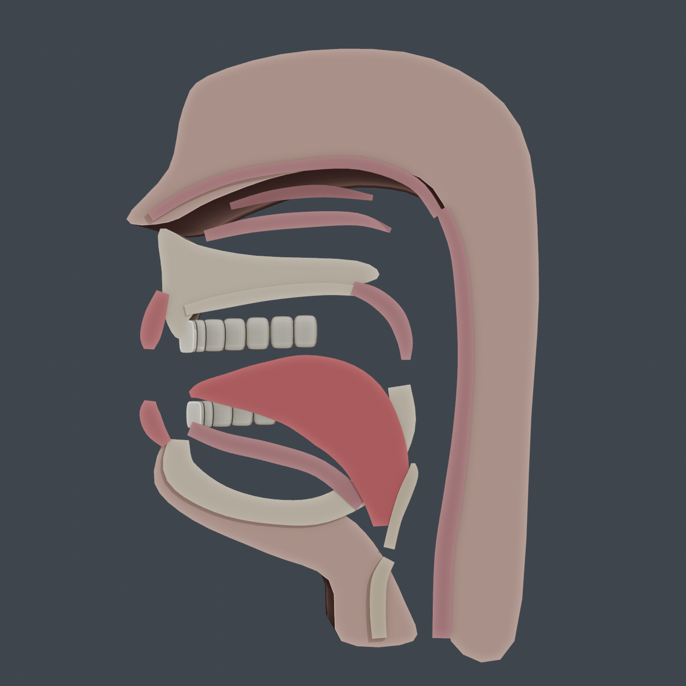
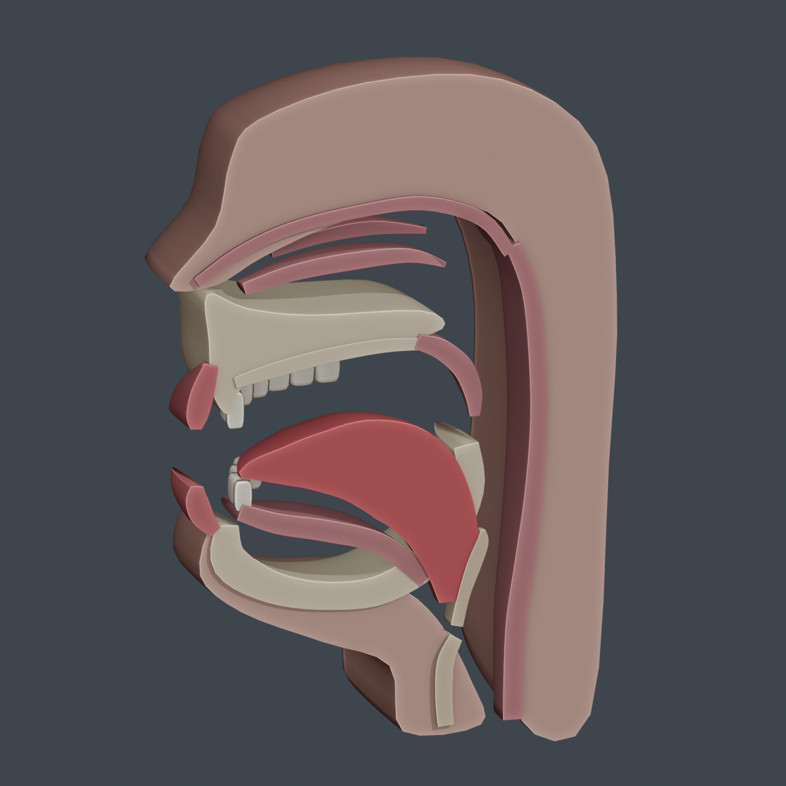
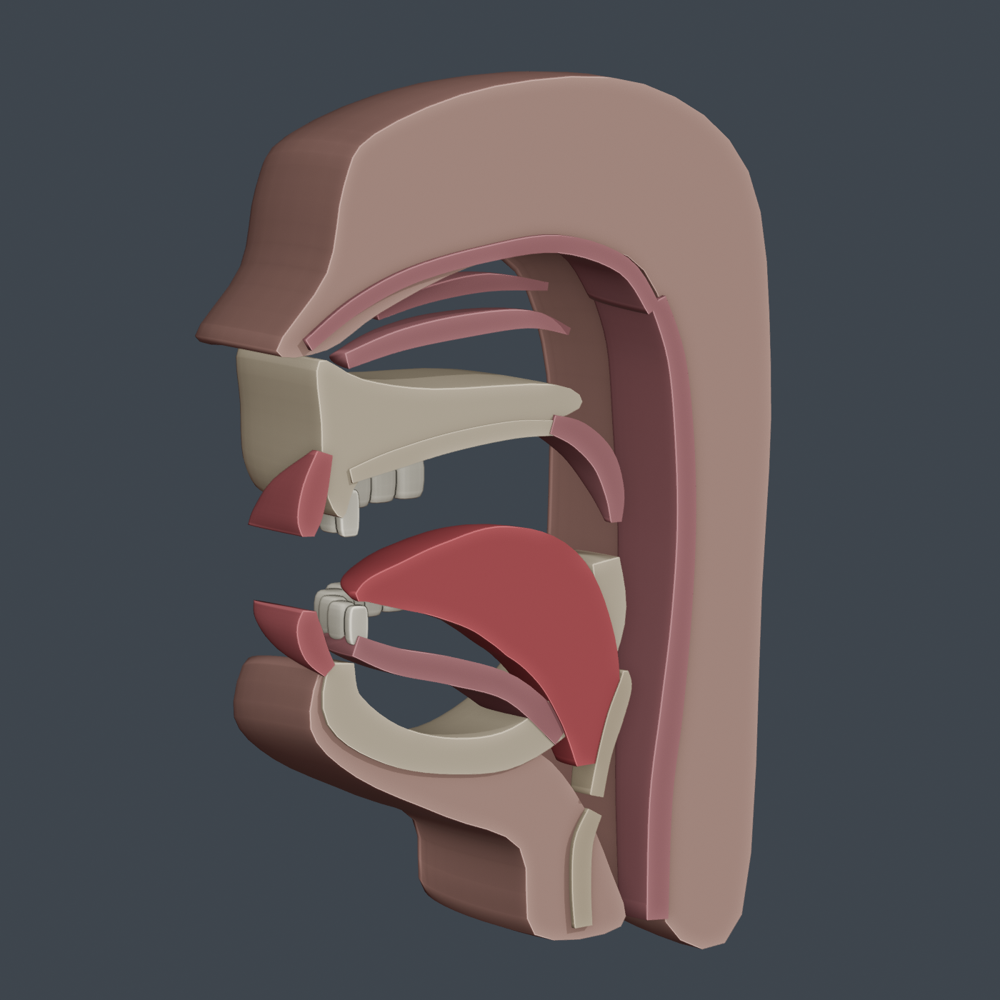

# نموذج المجرى الصوتي — Vocal tract

نموذج تشريحي ثلاثي الأبعاد في مقطع سهمي، مع أجزاء منفصلة قابلة للتحرير في Blender.

## الملفات

- [تحميل الحزمة كاملة](vocal_tract/vocal_tract_package.zip)
- [ملف Blender](vocal_tract/vocal_tract.blend)
- [نموذج GLB](vocal_tract/vocal_tract.glb)
- [سكربت البناء](vocal_tract/build_vocal_tract.py)
- [ملاحظات النموذج والطوبولوجيا](vocal_tract/NOTES.md)

## المعاينة

يتضمن النموذج 18 جزءًا تشريحيًا منفصلًا. لم تُضف عظام تحكم أو حركة. اجتازت المجسمات فحوص الحواف غير المتشعبة والوجوه ذات المساحة الصفرية، وتم اختبار إعادة استيراد GLB. تحتاج تشوهات الحركة المستقبلية إلى اختبار بعد تركيب نظام التحكم.

لم تُرفق صورة مرجعية مع التعليمات؛ النموذج قاعدة تشريحية مبسطة وليست إعادة بناء طبية معتمدة.
