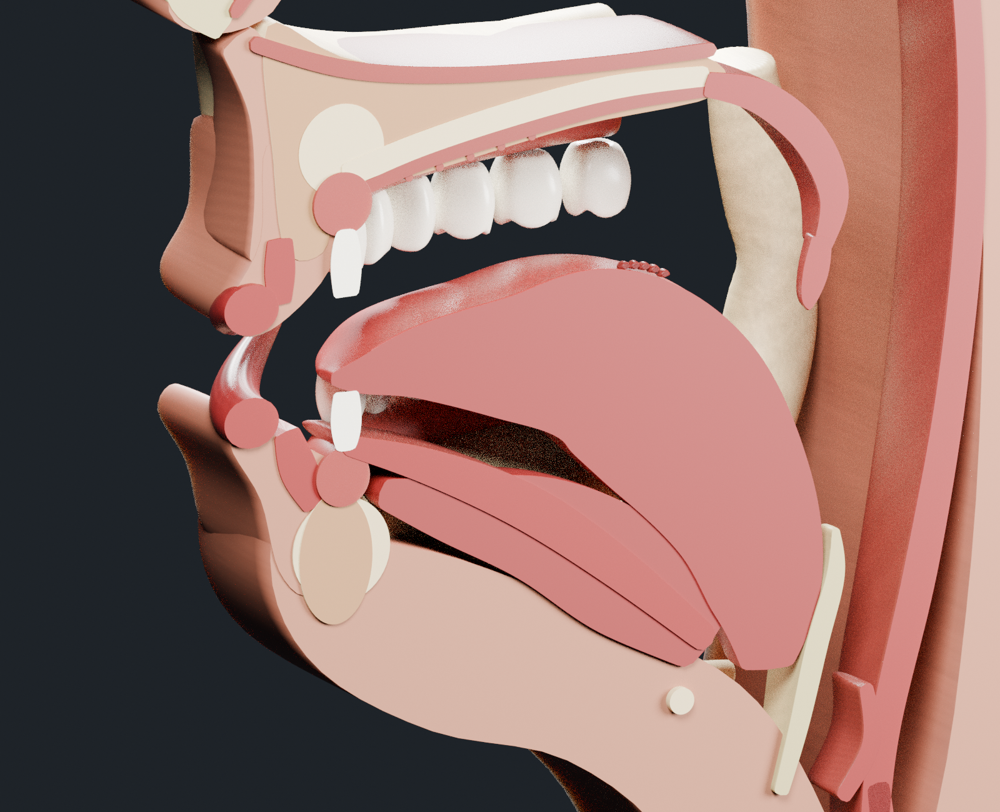

# المجرى الصوتي — النسخة الثانية

نموذج تشريحي ثلاثي الأبعاد أُعيد بناؤه بتفاصيل أكثر وأبعاد اسمية لرأس بالغ، مع أجزاء مستقلة وشبكات أصلية كاملة لتهيئته للتحريك لاحقًا.

- [تحميل الحزمة كاملة](vocal_tract/vocal_tract_package.zip)
- [ملف Blender القابل للتحرير](vocal_tract/vocal_tract.blend)
- [ملف GLB بخامات مضمنة](vocal_tract/vocal_tract.glb)
- [سكربت إعادة البناء](vocal_tract/build_vocal_tract.py)
- [تفاصيل الأبعاد وتجهيز التحريك](vocal_tract/NOTES.md)
- [نتائج التحقق](vocal_tract/validation.json)

## التفاصيل الجديدة

تيجان أسنان بمناطق إطباق ونتوءات للأضراس وجذور منفصلة، لثة وعظم سنخي، ثنيات الحنك، أخدود اللسان وحليمات خلفية، محارات أنفية، لسان المزمار وطيات الحنجرة، العظم اللامي، المريء والقصبة الهوائية وحلقاتها الغضروفية، وفقرات عنقية داعمة. يحتوي الملف على 77 مجسمًا أصليًا و12 خريطة خامة مضمنة.

## معاينة

## الأبعاد والتحريك

| الجزء | البعد الكامل التقريبي |
| --- | --- |
| اللسان | 80 مم أمام/خلف × 58 مم عرضًا |
| الشفاه | 52 مم عرضًا |
| الفك السفلي | 118 مم عرضًا |
| المنطقة المعروضة من الرأس والرقبة | 273 مم ارتفاعًا |

الملف مضبوط بالمتر، مع عرض الأبعاد بالمليمتر. الشبكات الأصلية ثنائية الجانب، والمقطع السهمي ناتج عن آخر Boolean modifier قابل للتعطيل. اللسان والشفاه والحنك الرخو لها حلقات رباعية ومجموعات رؤوس لمناطق الحركة، ويوجد مرجع لمحور الفك ومواضع مفصليه.

اجتازت الشبكات الأصلية فحوص الإغلاق والحواف غير المتشعبة والوجوه ذات المساحة الصفرية. نجح اختبار دوران مرجع الفك 12° مع ثبات الأسنان العلوية، وإعادة استيراد GLB بخاماته. **لم يُضف rig أو تحريك محفوظ؛ يتطلب التحريك الفعلي تركيب العظام والأوزان واختبار التشوه والتلامس.**

هذا نموذج تشريحي اصطناعي بأبعاد اسمية، وليس مسحًا طبيًا أو إعادة بناء لشخص محدد. راجع [الملاحظات](vocal_tract/NOTES.md) لمعرفة حدود النموذج وطريقة العمل على الشبكات الكاملة.
